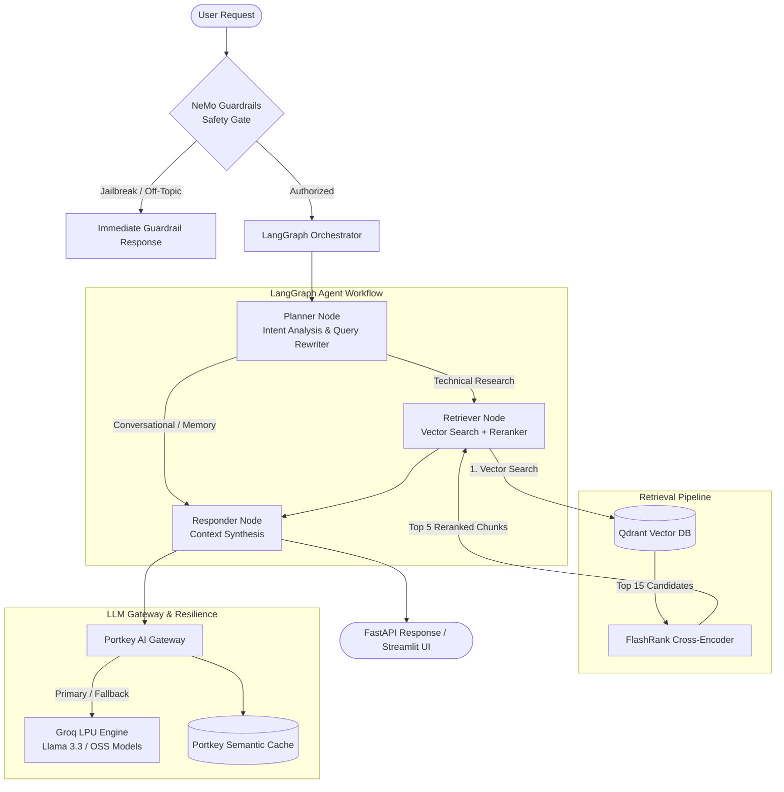

# Enterprise Agentic RAG

[](LICENSE)
[](pyproject.toml)
[](https://fastapi.tiangolo.com)
[](https://langchain-ai.github.io/langgraph/)
[](https://qdrant.tech)
[](https://pydantic.dev/logfire)

A production-ready, agentic Retrieval-Augmented Generation (RAG) system engineered for enterprise technical documentation. Built with **NeMo Guardrails**, **LangGraph** multi-turn agent workflows, **Qdrant** vector search, **FlashRank** semantic reranking, **Portkey AI** gateway routing, and an automated **Ragas** evaluation suite.

---

## Architecture Overview



---

## Key Features

- **Two-Tier Safety Gate**: Intercepts prompt injections, jailbreaks, and out-of-scope domain queries at the perimeter using [NeMo Guardrails](https://github.com/NVIDIA/NeMo-Guardrails) and Colang 1.0 rules.
- **Agentic Planning & Intent Routing**: Powered by [LangGraph](https://github.com/langchain-ai/langgraph), intelligently determining whether queries require real-time vector retrieval or multi-turn conversational memory.
- **High-Precision Retrieval & Local Reranking**: Combines dense vector search via [Qdrant](https://qdrant.tech/) with local ONNX cross-encoder re-scoring via [FlashRank](https://github.com/PrithivirajDamodaran/FlashRank) to eliminate retrieval noise.
- **Resilient Multi-Provider Gateway**: Routes inference through [Portkey](https://portkey.ai/) with automated fallbacks (e.g., Llama 3.3 70B &rarr; Llama 3.1 8B), response caching, and rate-limit retries.
- **Adaptive Embedding Layer**: Uses Google Gemini embeddings (`gemini-embedding-2-preview`) with automated fallback to local HuggingFace models (`sentence-transformers/all-mpnet-base-v2`).
- **Universal Multi-Format Ingestion**: Ingests, cleans, and chunks enterprise files across PDF, HTML, plain text, DOCX, and PPTX formats.
- **Full-Stack Observability**: End-to-end distributed tracing across all ingestion tasks, API endpoints, agent nodes, and UI interactions with [Pydantic Logfire](https://pydantic.dev/logfire) and LangSmith.
- **Comprehensive Evaluation Suite**: In-app evaluation dashboard measuring Ragas metrics (Faithfulness, Relevancy, Precision, Recall, Correctness), tool execution accuracy, and Guardrail confusion matrix benchmarks.

---

## Tech Stack

| Domain | Technology | Purpose |
|---|---|---|
| **Orchestration** | LangGraph, LangChain | State graph routing, execution flow, session checkpointer |
| **Safety & Rails** | NVIDIA NeMo Guardrails | Input sanitation, jailbreak prevention, domain scoping |
| **Vector Database** | Qdrant | Dense vector indexing and similarity search |
| **Reranker** | FlashRank (ms-marco-MiniLM-L-6-v2) | Low-latency local cross-encoder semantic re-scoring |
| **Inference Gateway** | Portkey AI, Groq | Gateway load-balancing, fallback routing, response caching |
| **Observability** | Pydantic Logfire, LangSmith | Distributed tracing, span capture, performance telemetry |
| **Evaluation** | Ragas, DeepEval | Golden dataset benchmarks and quantitative RAG metrics |
| **Frontend & API** | FastAPI, Streamlit | Async REST API backend and interactive chat / eval interfaces |

---

## Project Structure

```text
├── app/
│   ├── agents/               # LangGraph state definition, graph workflow, and agent nodes
│   │   ├── nodes/            # Planner, retriever, and responder implementations
│   │   ├── graph.py          # StateGraph compilation & memory checkpointer
│   │   └── state.py          # AgentState TypedDict schema
│   ├── gateway/              # Portkey AI client, fallback config, and cache headers
│   ├── guardrails/           # NeMo Guardrails configs, Colang policies, and initialization
│   ├── ingestion/            # Parsing, chunking, and Qdrant indexing pipeline
│   │   ├── chunking/         # Boundary-aware paragraph splitters
│   │   └── loaders/          # Parsers for PDF, HTML, Office (DOCX/PPTX), and TXT
│   ├── services/retrieval/   # Embedding probes, Qdrant client, and FlashRank reranker
│   ├── config.py             # Global runtime settings and environment variables
│   └── main.py               # FastAPI application entrypoint with Logfire lifecycle
├── evals/                    # Evaluation harness, Ragas benchmarks, and Streamlit dashboard
├── ui/                       # Streamlit multi-turn conversational chat interface
├── DATA/                     # Raw input documentation directory
├── .env.exmaple              # Environment variable template
├── pyproject.toml            # Project dependencies and packaging metadata
└── LICENSE                   # MIT License
```

---

## Getting Started

### 1. Prerequisites

- Python 3.12+
- [uv](https://docs.astral.sh/uv/) (recommended) or `pip`
- [Qdrant Cluster or Cloud Instance](https://cloud.qdrant.io/)
- API Keys: Groq, Portkey, Google Gemini, and Logfire (optional for tracing)

### 2. Installation

Clone the repository and install dependencies:

```bash
git clone https://github.com/your-username/entreprise-rag.git
cd entreprise-rag

# Using uv (fastest)
uv sync

# Or using pip
python -m venv .venv
source .venv/bin/activate  # On Windows: .venv\Scripts\activate
pip install -r requirements.txt
```

### 3. Environment Configuration

Create a `.env` file in the root directory based on `.env.exmaple`:

```bash
cp .env.exmaple .env
```

Fill in the required keys:

```dotenv
# Reasoning Engines & Gateway
GROQ_API_KEY="your-groq-api-key"
GROQ_FALLBACK_API_KEY="your-backup-groq-key"
PORTKEY_API_KEY="your-portkey-api-key"

# Vector Database (Qdrant)
QDRANT_API_KEY="your-qdrant-api-key"
QDRANT_CLUSTER_ENDPOINT="https://your-cluster-url.qdrant.tech:6333"

# Embeddings & Guardrails
GEMINI_API_KEY="your-gemini-api-key"

# Observability
LOGFIRE_TOKEN="your-logfire-token"
LANGSMITH_API_KEY="your-langsmith-key"

# Evaluation Judge (optional, isolates eval tokens)
JUDGE_GROQ="your-groq-eval-key"
```

---

## Usage

### Ingesting Documents

Process documents from the `DATA/` directory, chunk them, embed, and index them into Qdrant:

```bash
# Ingest DATA directory (creates collection if missing)
python -m app.ingestion.processor DATA

# Ingest and clean-recreate the collection from scratch
python -m app.ingestion.processor DATA --wipe
```

### Starting the FastAPI Backend

Launch the REST API server:

```bash
uvicorn app.main:app --host 0.0.0.0 --port 8000 --reload
```

- Interactive OpenAPI docs: [http://localhost:8000/docs](http://localhost:8000/docs)
- Agent Workflow Diagram: [http://localhost:8000/graph](http://localhost:8000/graph)

#### Example Query:

```bash
curl -X POST "http://localhost:8000/query" \
     -H "Content-Type: application/json" \
     -d '{"q": "How does SR-IOV optimize network performance in Kubernetes?", "thread_id": "session-101"}'
```

### Launching the Chat Interface

Start the Streamlit user chat application:

```bash
streamlit run ui/app.py
```

### Running the Evaluation Dashboard

Run end-to-end Ragas evaluation runs, measure Guardrail accuracy, and view quality scores:

```bash
streamlit run evals/app.py
```

---

## Evaluation Metrics

The evaluation suite executes across golden datasets to assess accuracy and safety:

- **Faithfulness**: Validates whether synthesized answers strictly follow retrieved context without hallucination.
- **Answer Relevancy**: Assesses how directly the output addresses the user's inquiry.
- **Context Precision & Recall**: Measures the signal-to-noise ratio and coverage of retrieved vector chunks against reference context.
- **Tool Correctness**: Verifies agent planning decisions (direct response vs. vector retrieval) against ground truth.
- **Guardrail Metrics**: Computes True Positive / False Positive rates on adversarial jailbreak attempts and off-topic queries.

---

## Contributing

Contributions are welcome! Please open an issue or submit a pull request for improvements, bug fixes, or new features.

1. Fork the Project
2. Create your Feature Branch (`git checkout -b feature/AmazingFeature`)
3. Commit your Changes (`git commit -m 'Add some AmazingFeature'`)
4. Push to the Branch (`git push origin feature/AmazingFeature`)
5. Open a Pull Request

---

## License

Distributed under the MIT License. See [LICENSE](LICENSE) for details.
